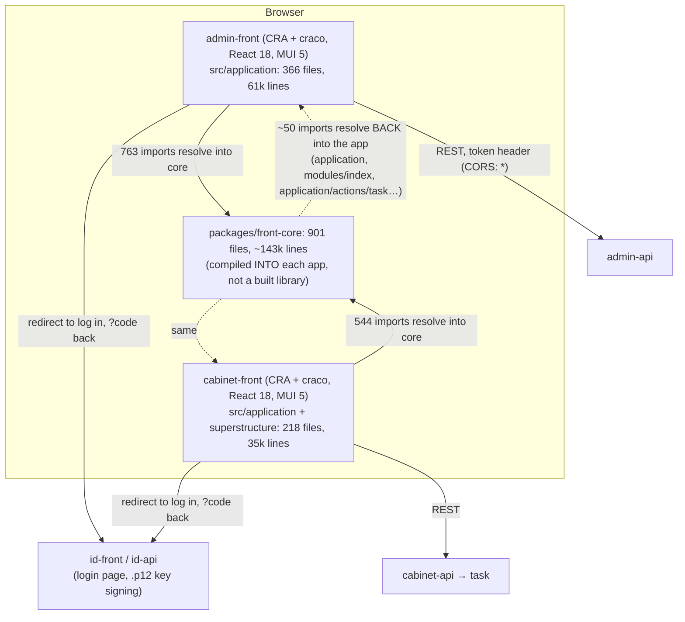

# PoC: decoupling admin & cabinet from the shared MUI core

_Status: investigation and plan only. No app code written yet. Branch `poc/decouple-ui`, 2026-11-17._

**Goal (from the product designer):** each app (`admin-front`, `cabinet-front`) should be free to use
any React UI framework (shadcn/ui + Tailwind, HeroUI, possibly Next.js…) without the other app or a
shared core forcing MUI. First practical step: **admin moves to a new UI framework while cabinet
keeps working unchanged.**

---

## TL;DR

- **The shared core is less tangled than it looks.** Its *non-UI* half (API client, login/session,
  Redux store, digital signing, i18n strings, table data logic, form-logic helpers) is ~165 files
  and almost free of MUI: **3 files** leak UI. The *UI* half is where MUI lives: 482 of
  front-core's 901 files import `@mui`, and **two thirds of all core code is the schema-form
  engine** (`JsonSchema`, ~95k lines).
- **The real coupling isn't the imports, it's the build trick.** Both apps compile front-core's
  source *as if it were their own* (a webpack "layered folders" lookup). That works both ways:
  core code silently reaches back into each app (about 50 import sites, some pointing at
  cabinet-only screens). Any new admin app has to replace this hidden wiring with explicit wiring.
- **Recommendation: option C, a new admin app beside the old one.** Build a new admin app (Vite,
  your choice of UI kit) on the *same web address* as the old one. It reuses the core's non-UI
  half through a thin "headless" layer. The old admin keeps serving every screen not yet migrated.
  Screens move one at a time, users stay logged in across both, and **cabinet and front-core
  aren't touched in phase 1**.
- **Phase 1 slice:** new app shell + login/logout + **Units list → Unit detail** (a real
  list/detail screen in Users), plus a time-boxed spike that renders the Unit form through a new
  "headless schema engine + new-kit renderers" setup.
- **You decide:** the UI kit (shadcn/ui, HeroUI or Mantine, compared in §8), Vite vs Next.js
  (we recommend Vite), and the other items in §11.

---

## Glossary (for the rest of the doc)

| Term | Meaning here |
|---|---|
| **front-core / core** | `packages/front-core`, the shared code both apps are built from |
| **UI kit** | The component library: MUI today, shadcn/ui, HeroUI or Mantine tomorrow |
| **Headless** | Logic with no visual components: API calls, state, validation. Any UI kit can sit on top |
| **Renderer** | The visual component that draws one form field type (e.g. "date", "select") |
| **Overlay / layered lookup** | The build trick: `import 'components/X'` checks the app's folders first, then core |
| **Strangler** | Replacing a system piece by piece while old and new run side by side |
| **Shell** | The app frame: sidebar navigation, header, user menu, page layout |

---

## 1. Current architecture



### How front-core gets into each app

1. `package.json` declares `"core": "file:../../packages/front-core"`, so npm **symlinks** it into
   `node_modules/core`. It isn't built or versioned on its own; each app compiles its raw source.
2. Each app's `craco.config.js` replaces webpack's module lookup with a **layered folder list**:
   - admin: `src/application` → `node_modules/core` → `src` → `node_modules`
   - cabinet: `src/superstructure` → `src/application` → `node_modules/core` → `src` → `node_modules`

   So `import X from 'components/DataTable'` means "the app's file if it exists, otherwise core's".
3. **The lookup also runs from inside core.** Core files that import `application`,
   `modules/index`, `reducers`, `theme` or `actions/users` get *the app's* version. Core is a
   template that each app fills in, not an independent library (evidence in §3.4).
4. Docker: each app's `Dockerfile` copies front-core into the image via a compose
   `additional_contexts: core`, then runs `craco build` and serves `build/` from nginx on :8080.
   Runtime settings (`backendUrl`, `idAuthLink`, `clientId`…) come from `/config.json`, fetched at
   startup (`front-core/helpers/configLoader.js`).
5. Login: the app redirects to id-front with `redirect_uri = window.location.origin`
   (`components/Auth/LoginScreen.jsx`). id-front signs with the user's .p12 key and sends back
   `?code=…&state=…`. The app swaps the code for a token (`actions/auth.js → requestAuth`) and
   stores it in **`localStorage['token']`**, which is per web address. admin-api answers any
   origin (`Access-Control-Allow-Origin: *`, `admin-api/src/lib/cors.ts`).

> Side note: `components/{admin,cabinet}-front/src/core` are dangling symlinks
> (`→ ../../front-core`, which doesn't exist). They're harmless leftovers but confusing.

---

## 2. What front-core provides: UI vs non-UI

Counted with `find`/`grep` over `.js/.jsx` files, excluding translations and tests ("MUI files" =
files with an `@mui/*` import).

| Area | Folder(s) | Files | Lines | MUI files | What it is |
|---|---|---:|---:|---:|---|
| **Non-UI** | `services/api` | 3 | – | 0 | fetch wrapper, retries, token header, Sentry |
| | `actions/` (auth, app, error, users…) | 9 | 530 | 0 | Redux thunks: login/logout, user info, errors |
| | `reducers/`, `store/` | 10 | 605 | 0 | Redux store, browser history singleton |
| | `services/eds` | ~6 | 827 | 0 | Digital signing (EDS/.p12) via node-forge |
| | `services/dataTable` | ~13 | – | 0 | Table data: paging, filters, sort, presets (Redux) |
| | `helpers/` | 111 | 7,001 | **1** | config loader, storage, access checks, `evaluate`, dates… |
| | `hooks/` | 8 | 170 | 0 | small React hooks (undo, prompt, broadcast channel) |
| | `translation/` | 6 | 20,152 | 0 | uk-UA, en-GB, de-DE, fr-FR, nl-NL strings |
| | `JsonSchema/helpers` | 20 | 1,738 | 0 | **form logic**: validation, triggers, hidden/required/readonly |
| **UI** | `components/JsonSchema/elements` | 229 | 76,156 | 146 | ~86 form field renderers |
| | `components/JsonSchema/editor` + `editor-old` | 163 | 15,527 | 139 | schema/form editor (admin tooling), two copies |
| | other `components/*` (~70 folders) | ~200 | ~26k | ~140 | DataTable, dialogs, file preview, P7S sign form, snackbars, BPMN… |
| | `layouts/` | 19 | 2,789 | 17 | LeftSidebar, Header, Navigator (the shell) |
| | `modules/` (profile, styleGuide, userProfile) | 59 | 6,562 | 33 | whole shared pages |
| | `theme.js`, `App.jsx` | 2 | ~830 | 2 | base MUI theme, app root with all providers |

**How tangled?** At the **folder level, not very.** The non-UI folders import UI in only 3 places:
`helpers/renderOneLine.js` (MUI Tooltip), `helpers/createRoutes.jsx` (`PrivateRoute`), and
`helpers/checkAuthPhoneValidation.js` (`ValidatePhoneMessage`). `Snackbars/Message` looks like UI
but is a plain data class.

**Inside the UI components, very.** They mix logic and visuals in the same file:

- `components/Auth/index.jsx` is a class component that runs the whole login and bootstrap
  sequence (code exchange, units, settings, localization, navigation tree) *and* renders MUI
  screens.
- Most form field renderers fetch data, dispatch Redux actions and evaluate schema expressions
  inside the same component that draws the MUI field.
- `SchemaForm.jsx` (the per-field wrapper) holds the hidden/readonly/default-value effects next to
  the rendering.

The logic half is reusable *after extraction*. Today it isn't importable separately.

---

## 3. Coupling inventory

### 3.1 `@mui` imports per package

| Package | Files importing `@mui` | Import statements | By package | `makeStyles`/`withStyles` files |
|---|---:|---:|---|---:|
| `packages/front-core` (901 files) | **482** | 1,312 | icons 594 · material 414 · styles 295 · x-date-pickers 7 · x-data-grid 2 | 292 |
| `admin-front/src` (363 files) | **190** | 535 | material 240 · icons 217 · styles 70 · x-date-pickers 6 · x-tree-view 2 | 71 |
| `cabinet-front/src` (220 files) | **92** | 218 | material 87 · icons 69 · styles 58 · x-date-pickers 2 · x-data-grid 2 | 58 |

**Checking the earlier "~92 cabinet call sites" figure:** confirmed as **92 files** (218 import
statements). But that's only cabinet's *own* code. Cabinet also renders core's MUI: 112 of its
imports go to `JsonSchema`, and its shell, dialogs and tables come from core too. A cabinet-only
migration is bigger than 92 files. The same holds for admin.

Also: 3 core files use MUI-based third-party inputs (`material-ui-phone-number`,
`mui-currency-textfield`, `material-ui-chip-input`), so those dependencies need replacing too.
MUI's legacy `@mui/styles` (`makeStyles`) appears in **421 files** across the three packages; it
is deprecated, and it reads tokens straight off the MUI theme.

### 3.2 What each app takes from core

Every bare import in each app was resolved through its real lookup order:

| | Resolves to the app's own files | Resolves into **core** |
|---|---:|---:|
| admin-front | 146 (+147 to `src/`) | **763** |
| cabinet-front | 175 (+85 to `src/`) | **544** |

The biggest core dependencies, by import count:

- **admin:** `JsonSchema` 104 · `DataTable` 60 · `actions/error` 59 · `services/api` 42 ·
  `Snackbars` 40 · `ConfirmDialog` 39 · `services/dataTable` 34 · `Preloader` 33 ·
  `hooks/asModulePage` 30 · `helpers/checkAccess` 27 · `configLoader` 24 · `store` 21
- **cabinet:** `JsonSchema` 112 · `helpers/evaluate` 29 · `services/dataTable` 26 · `Preloader` 25 ·
  `assets/img` 22 · `store`/`services/api`/`actions/error` 16 each · `DataGridPremium` 15

Admin modules ranked by core imports: workflow 236 · users 134 · registry 78 · reports 43 ·
customInterfaces 30 · everything else ≤17.

### 3.3 Which core pieces each app uses (direct imports, top-level folders)

| Used by | Count | Pieces |
|---|---:|---|
| **both** | 20 | Auth, ConfirmDialog, DataTable, EmptyPage, ErrorScreen, FileDataTable, FullScreenDialog, HighlightText, **JsonSchema**, Label, ModulePage, Preloader, Scrollbar, Select, Snackbars, StimulSoft, LeftSidebar layout, layout components, profile, styleGuide |
| **admin only** | 10 | AppRouter, BpmnAi, BpmnSchema, ChipTabs, CodeEditDialog, Editor, FileViewerDialog, MaterialSymbolIcon, WebChat, muiIcons |
| **cabinet only** | 10 | Altcha, BlockScreen, BlockScreenReforged, DataGridPremium, Disclaimer, FilePreview, KeyboardDatePicker, P7SForm (signing UI), TreeList, userProfile |
| core-internal only | 24 | used only by other core pieces |
| no direct importer found | 8 | FileDataList, FormElementsGroup, PKCS7SignerExample, SelectFilesDialog, Snackbar, Table, TreeView, TwoFactorCode (possibly dead code) |

### 3.4 App-specific vs inherited: overrides, and core reaching back

**Files where an app shadows core** (same path, the app wins):

- **admin (10):** `theme.js`, `App.jsx`, `translation/uk-UA.js`, `layouts/LeftSidebar.jsx`,
  `layouts/components/Header.jsx`, `layouts/components/Navigator/index.jsx`,
  `components/JsonSchema/elements/index.jsx`, `modules/profile/components/ProfileAppbar.jsx`,
  `actions/users.js`, `actions/workflowProcess.js`
- **cabinet (8):** `superstructure/theme.js`, `layouts/LeftSidebar.jsx`, `Header.jsx`,
  `Navigator/Item.jsx`, `JsonSchema/elements/index.jsx`, `actions/users.js`, `actions/app.js`,
  `reducers/app.js`

**Core imports that only exist in the apps** (the inversion; core can't be built alone):

| Import inside core | Sites | Where it lands |
|---|---:|---|
| `application/actions/task` | 16 | each app's task actions (JsonSchema, file preview) |
| `application/actions/registry` | 13 | form elements that query registries |
| `application/actions/externalReader`, `files`, `bpmnAi` | 8 | form elements, BPMN AI |
| `modules/tasks/pages/Task/...` (ExtReaderMessages, SuccessMessage) | 5 | **cabinet-only screens**, used by DocumentSharing, Payment and Popup elements |
| `modules/tasks/components/CreateTaskButton` | 1 | cabinet-only, used by the core Navigator |
| `application`, `modules/index`, `reducers` | 5 | the app's module list, access rules and reducers (Auth, AppRouter, Header, store) |
| `theme` | 27 | whichever theme the app provides |
| `actions/registry`, `actions/task`, `actions/files`, `actions/snippets`… | ~12 | app-provided actions |

So core is partly **cabinet-shaped**: some shared form elements only work because cabinet
supplies `modules/tasks/...`.

---

## 4. The schema-driven forms (the biggest piece)

### How it works today

```
schema (JSON from the workflow designer, or a local JS schema in admin)
   │
   ▼
SchemaForm.jsx: one per field
   ├─ logic: hidden? readonly? required? default value? (JsonSchema/helpers, helpers/evaluate)
   ├─ picks the renderer: name = control ?? type + ".element"
   │                      "form.group" → FormGroup, "string"+".element" → StringElement
   │                      looked up in { ...elements/index.jsx registry, ...customControls }
   └─ renders <Renderer value onChange errors schema … />   ← MUI lives here
         │
         └─ Object/Array/FormGroup renderers recurse into SchemaForm for children
validation: validateData / validateDataAsync (ajv) + triggers (handleTriggers…)
```

- The registry is already a plug-in point: each app overrides `elements/index.jsx` (admin enables
  **37** of the ~86 types; cabinet's override imports 89), and `SchemaForm` accepts
  `customControls`.
- The pure-logic helpers are clean (20 files, 0 MUI).
- The renderers aren't thin. Of 229 element files, 146 import MUI, and many also fetch data,
  dispatch Redux actions and run schema expressions.
- Admin uses the engine in two ways. It **renders forms** (e.g. the Unit page is a `SchemaForm` over
  a local schema), and it **edits schemas** (`JsonSchema/editor`, `CodeEditDialog`, Monaco). That
  editor tooling is admin-only but lives in core, in two copies (`editor`, `editor-old`, ~15.5k
  lines together).

### How it can keep working with a different UI kit

Split the engine into three layers so each app brings only the renderers:

```
@liquio/schema-engine   (headless, no UI kit)
  - field walker: schema + value → list of field descriptors
    { path, control, value, hidden, readonly, required, error, sample, onChange }
  - validation (ajv), triggers, default values, hidden/cleanup rules
  - React hooks: useSchemaForm(schema, value), useField(path)
       ▲                                       ▲
admin renderer pack (new kit)          cabinet renderer pack (MUI, today's elements)
  registry: { "string.element": Input,   registry: existing elements/index.jsx
              "toggle": Switch, … }        (unchanged; adopts the engine later)
```

- **Stage 1 (admin only, no core edits):** a new `<SchemaForm>` in the admin app reuses
  `JsonSchema/helpers/*` and `helpers/evaluate` as they are, with renderers built in the new kit.
  Start with the 7 types the Unit page needs: `string`, `object`, `form.group`, `text.block`,
  `toggle`, `unit.list`, `user.list`.
- **Stage 2:** move the per-field logic that lives inside `SchemaForm.jsx`'s effects (default
  values, hide-and-clear, required/readonly re-evaluation) into the engine package. Cabinet can
  later adopt it without changing its look.
- **Stage 3 (per element type, as admin needs it):** for data-heavy elements (registry selects,
  user/unit lists, files), separate *data fetching* (a hook in the engine or the admin app) from
  *drawing* (the new-kit renderer).
- **Not to rebuild early:** the ~50 element types admin doesn't enable, and the schema
  *editor*. The editor can keep running inside the old admin longest (see §5, option C).

Cost signal: admin's 37 types are the target, not all 86. Simple inputs (string, number, toggle,
select, radio, checkbox, date, textarea, divider, text.block) take hours each in a modern kit.
Composite or data-backed ones (Table, Spreadsheet, SelectFiles, UserList, UnitList, CodeEditor,
SchemaEditor, Tabs, Modal) take days each.

---

## 5. Target architecture options

### Option A: strangler inside the existing CRA admin app

Add Tailwind and the new kit to `admin-front`, and rewrite screens one by one while MUI keeps
running for everything else.

- **Build/dev:** stays CRA + craco (react-scripts 5 is no longer maintained). Tailwind goes in
  through craco's PostCSS config. Tailwind's CSS reset clashes with MUI's `CssBaseline`, so it
  needs to be disabled or scoped. Two styling systems ship in one bundle.
- **Docker/nginx:** no changes.
- **Auth/routing:** fully continuous (same app, same Redux, same react-router v5).
- **Decoupling:** none structurally. Admin still compiles front-core through the overlay, so MUI
  stays a dependency until the *last* screen moves. Next.js is off the table.
- **Cost:** cheapest to start, most expensive overall. Every screen is first migrated inside a
  MUI shell, and the build/tooling migration still has to happen at the end.

### Option B: new admin app on a headless core, built to parity, then switched

First extract front-core's non-UI half into its own package (`packages/platform`), leaving
forwarding files so cabinet's imports still work. Then build a new admin app (Vite or Next.js) on
top until it matches the old one, then switch over.

- **Build/dev:** clean modern stack (Vite, TypeScript, Tailwind if wanted). The new package is
  real source that Vite watches, so it *does* hot-reload (the "front-core never hot-reloads"
  problem in CLAUDE.md goes away for it).
- **Docker/nginx:** new Dockerfile (same node-build → nginx pattern); config.json mounted the same
  way.
- **Auth/routing:** the new app re-implements the login callback and must reproduce every route
  path. No continuity until switch-over: two admins, two addresses, separate logins.
- **Decoupling:** complete.
- **Cost:** the highest risk profile. The extraction touches front-core (cabinet risk) before any
  visible benefit, and there's a long gap before parity with admin's 20 modules and 78 routes,
  including the BPMN designer (workflow, 16k lines) and reports (16k lines).

### Option C (recommended): new admin app beside the old one, same address

B's clean new app with A's step-by-step rollout, done at the **routing layer**, not inside one
bundle.

```
                    poc-admin.liquio.local  (one origin → one localStorage → one login)
                                 │
                   ┌─────────────┴──────────────┐
          migrated paths                 everything else
     (/, /users/units, /users/units/:id …)  (/workflow, /reports, …)
                   │                            │
     NEW admin app (Vite + new kit)      OLD admin-front (CRA + MUI, untouched)
                   │                            │
                   └──── both read localStorage['token'], call admin-api ────┘
```

- **Routing:** a small front door sends each path to the new or the old app. In development
  that's the Vite dev server's proxy; in Docker/K8s it's nginx or ingress path rules. Moving a
  screen means moving its path to the "new" list. Route paths stay identical, so bookmarks and
  deep links keep working.
- **Auth continuity:** same origin means the same `localStorage['token']`, so a user logged in on
  one side is logged in on the other. Crossing between apps is a full page load (acceptable for
  an admin tool). Logout from either side clears the shared token. id-front's `redirect_uri` is
  the origin, which is already whitelisted for `poc-admin.liquio.local`.
- **Headless layer:** in phase 1 the new app imports front-core's non-UI files **read-only**
  through a small "platform" facade, with **no edits to front-core**, so cabinet is untouched by
  construction. A Vite resolver plugin recreates the layered lookup for just that subset and
  **fails the build** if anything pulls in `@mui`, `components/`, `layouts/` or `modules/` from
  core. It becomes a formal `packages/platform` (option B's extraction) only once the
  boundary is proven, with forwarding files so cabinet still resolves the old paths.
- **Shell during coexistence:** two visually different shells until the last screen moves.
  Mitigation: migrate the most-used screens first, and optionally re-theme the old MUI shell
  toward the new tokens (cheap with the existing theme work).
- **Heavy screens:** the BPMN designer, schema editor and reports can stay in the old app until
  late, with no pressure to rewrite them early.
- **Cost:** moderate up front (shell + login + routing front door), then screen-by-screen at a
  steady rate. It's the only option where users get value in the first weeks *and* the end state
  is fully decoupled.

### Considered and set aside

- **Module Federation / micro-frontends (single-spa):** mounting old MUI screens *inside* the new
  shell at component level. Two React roots, two styling systems and shared Redux across
  boundaries make it much more complex than the route-level split, for little gain in a back-office
  tool.
- **Iframe-embedding old screens in the new shell:** technically works (same origin), but the
  UX suffers (scrolling, dialogs, deep links). Keep it only as a fallback for one stubborn screen.

### Comparison

| | A: in-place strangler | B: new app to parity | **C: new app beside old** |
|---|---|---|---|
| First visible result | days | months | **~1–2 weeks** |
| Cabinet risk in phase 1 | none | medium (core extraction) | **none** |
| Login continuity | full | none until switch | **full (same origin)** |
| Build tooling | stuck on CRA | modern | **modern for new screens** |
| MUI leaves admin | only at the very end | at switch-over | **gradually, screen by screen** |
| Next.js possible | no | yes | yes (not recommended, §9) |
| Infra changes | none | new container | **new container + path routing** |
| Throwaway work | high (screens rebuilt twice) | low | **low** |

---

## 6. Recommendation

Go with **option C**, using a **Vite** single-page app for the new admin, a read-only platform
facade over front-core's non-UI code in phase 1, and **a new-kit renderer pack on top of a
headless schema engine** for forms. Cabinet and front-core aren't modified until the boundary is
proven. After that, front-core is split into `platform` (non-UI, shared), `schema-engine`
(headless, shared) and the existing MUI UI. The MUI UI then effectively becomes cabinet's own UI
package, which also unblocks cabinet's own migration later.

---

## 7. Phased plan

### Phase 0: decisions (you)
Pick the UI kit, confirm Vite, confirm the phase 1 slice, and decide whether phase 1 includes the
old-admin handoff (§11).

### Phase 1: admin on the new kit, thin vertical slice

**New code lives in** `components/admin-next/` (working name). Nothing under `packages/front-core`
or `components/cabinet-front` changes; a CI/grep check enforces that on the branch.

**1a. Foundation**
- Vite + React 18.3 (same as today, so the shared Redux 7 code works unchanged) + TypeScript for
  new files + the chosen kit, plus Tailwind if the kit needs it.
- A **platform facade** `src/platform/` that re-exports only these from front-core: `configLoader`,
  `storage`, `services/api`, `actions/auth` (`requestAuth`, `requestUserInfo`, `logout`),
  `actions/error`, `helpers/checkAccess`, `services/dataTable`, translations, and later
  `JsonSchema/helpers` + `helpers/evaluate`.
- A **Vite resolver plugin** that mirrors the layered lookup for that subset (the new app's
  `src/overrides` first, then front-core), and errors on any import of `@mui`, `react-jss`, or
  core's `components|layouts|modules`. The new app provides its own `reducers` module, which
  core's store expects.
- **Design tokens:** port the admin theme's deliberate tokens (palette, typography scale,
  `buttonGap`, `buttonIconSize`, divider, etc., per `CHANGES.md`) into the new kit's token system
  (CSS variables or a Tailwind theme). Tokens carry over; MUI component overrides don't.
- `public/config.json` with the same keys the old admin uses.

**1b. Shell + session**
- Login: unauthenticated → redirect to `idAuthLink?redirect_uri=<origin>/&client_id=…&state=…`
  (the same logic as `LoginScreen.jsx`). The callback `?code&state` runs `requestAuth` then
  `requestUserInfo`.
- A small `useSessionBootstrap()` hook that replaces the logic half of `components/Auth`: token,
  user info, units, user settings, and optionally the navigation tree and localization texts.
- Shell: sidebar navigation (from the same module/route list and `checkAccess` rules), header
  with user name, language switch and logout (`logout(true)`), plus 404 and an access-denied page.
- Router: React Router (current major version) with **the same paths** as today.

**1c. One list/detail screen: Users → Units**
- `/users/units`: units list with paging, search and sort, against admin-api through
  `services/dataTable` (headless) and a new-kit table (e.g. TanStack Table). Today's version is
  `modules/users/pages/UnitList` (6 files, ~900 lines).
- `/users/units/:unitId`: unit detail, view and save. Today's version is
  `modules/users/pages/Unit` (9 files, ~1.4k lines, a `SchemaForm` over a local schema).

**1d. Time-boxed spike (≈2–3 days): schema renderer on the new kit**
- Render the Unit detail through a new `<SchemaForm>` (headless helpers + new-kit renderers) for
  its 7 field types: `string`, `object`, `form.group`, `text.block`, `toggle`, `unit.list`,
  `user.list` (the last two can be read-only in the spike).
- Output: a short written verdict on how much of `SchemaForm.jsx` and the element logic was reusable
  as-is, and a realistic per-type cost for admin's 37 types.

**1e. (Optional, your call) Old-admin handoff on the PoC host**
- The Vite dev server on :8092 proxies every non-migrated path to an old-admin dev server from the
  same worktree on an internal-only PC port. Clicking "Workflow" in the new shell then opens the
  old MUI screen, still logged in. If skipped, phase 1 shows only migrated screens, and nav items
  for the rest are disabled or link out.

**Done when:**
1. Logging in at `poc-admin.liquio.local` with `admin.p12` lands in the new shell with the user's
   name. Reload keeps the session. Logout returns to id-front.
2. The units list pages, searches and sorts against real data, and a unit's detail can be opened
   and saved.
3. The new app's build contains **zero `@mui`** (the resolver plugin enforces this, and the
   production build is checked on the PC).
4. `git diff main -- packages/front-core components/cabinet-front` is empty. The old admin and
   cabinet still run unchanged on 8082/8081.
5. The spike verdict (1d) is written up in this folder.

### Phase 2: harden the boundary
- Promote the facade to `packages/platform`, moving non-UI code out of front-core and leaving
  forwarding files at the old paths so cabinet's imports are unchanged.
- Fix the inversion: replace `import … from 'application' / 'modules/index' / 'reducers'` inside
  platform code with explicit parameters (`createPlatform({ modules, reducers, initActions,
  access })`).
- Fix the 3 UI leaks in non-UI helpers.
- Extract `packages/schema-engine` (stage 2 in §4). Old and new admin keep sharing one
  implementation of the form logic.
- Dockerfile + nginx for the new app, with path-based routing to the old admin container, plus
  helm/ingress notes.

### Phase 3: migrate admin screen by screen
Suggested order: high-traffic and simple first, heavy tooling last. Roughly users → registry →
home/favorites/settings/healthCheck/processes → elastic/kibana/metrics/processStatistics →
fileLibrary/multiLang/mocks/customInterfaces → reports → workflow (BPMN designer + schema
editor). Each move is "build the screen in admin-next, add its path to the new-app list". Form
element types get built as screens need them.

### Phase 4: retire old admin, shrink front-core
Once no path routes to the old admin, delete it and the admin-only parts of front-core (schema
editor copies, CodeEditDialog, BpmnAi, BpmnSchema, admin theme). What remains of front-core's UI
is cabinet's, so cabinet's own migration can follow the same playbook with no admin constraint.

### Rough effort (one developer, agent-assisted; treat as order of magnitude)

| Phase | Estimate |
|---|---|
| 1 (foundation, shell, session, Units list/detail, spike) | 1.5–3 weeks |
| 2 (platform + schema-engine packages, Docker/routing) | 1–2 weeks |
| 3 (all 20 admin modules; workflow and reports dominate) | several months, steady and incremental |
| 4 | days |

---

## 8. UI kit candidates (you decide)

All three work with React 18, Vite and a token-driven theme. None ships an MUI-X-grade data grid,
so tables will use TanStack Table (headless) in all three cases.

| | **shadcn/ui** (Radix + Tailwind) | **HeroUI** (React Aria + Tailwind) | **Mantine** (own CSS, no Tailwind needed) |
|---|---|---|---|
| Model | Components are **copied into our repo** as source; we own and edit them | Installed npm package with themed components | Installed npm package, very broad set |
| Theming / tokens | CSS variables + Tailwind theme; maximal design control (it's our code) | Tailwind plugin with semantic color tokens; light/dark built in | CSS variables + theme object; light/dark built in |
| Fit for a dense, dark admin | Good, but tables, date pickers and tree views are assembled from recipes | Good-looking defaults, fewer data-dense components | **Strongest out of the box**: date/time pickers, tree, rich inputs, notifications, modals manager |
| Accessibility | Radix primitives, good | React Aria, excellent | Good |
| Upgrade story | Updates are manual (it's our code) | Version bumps; has had big API breaks between majors | Steady majors with migration guides |
| Matches "tokenize, don't hardcode" | Best: every value is ours, and Tailwind theme tokens are the source of truth | Good | Good |
| Agent/dev ergonomics | Excellent (huge ecosystem, the most examples) | Good | Good |
| Risk | More assembly work for complex widgets | Smaller ecosystem; framer-motion dependency | Not Tailwind (if Tailwind itself is a goal) |

Our engineering lean, for what it's worth: **shadcn/ui** if owning the components and design
control matter most, **Mantine** if the fastest route to admin's dense widgets matters most.
**HeroUI** is a fine middle ground if its look is close to what you want.

---

## 9. Vite vs Next.js

Admin is a logged-in, client-side tool. Its token lives in `localStorage` and the shared code
assumes a browser everywhere: 176 files touch `window`, `document` or storage, there are 121
class components, and there are module-level singletons (store, history, config). In Next.js,
nearly everything would be client-only (`"use client"` or static export), so server rendering
would add complexity with no benefit behind a login. Dynamic routes in static-export mode also
need workarounds.

**Recommendation: Vite.** It's a closer fit to how the app works today, has a simpler Docker
image (static files + nginx), and makes the same-origin coexistence of option C easy. Next.js
stays possible later for a *public-facing* cabinet if server rendering or SEO ever matters, which
is a separate decision.

---

## 10. Dev environment (PoC on the Windows PC)

- Nothing is built or served on the Mac. The PC agent pulls `poc/decouple-ui`, runs `npm install`
  (not `npm ci`) in `components/admin-next`, and serves it on **:8092**
  (`poc-admin.liquio.local`). `BROWSER=none` doesn't apply to Vite; the server must bind `0.0.0.0`
  and allow the `poc-admin.liquio.local` host (Vite's `server.host`/`server.allowedHosts`).
- Cabinet's PoC slot **:8091** stays unused in phase 1, since cabinet is unchanged by design.
- `poc-admin.liquio.local` is already in id's `liquio-portal` redirect list, and admin-api allows
  any origin, so **no backend config changes** are expected. The first login test confirms this.
- Unlike today's front-core, code reused through the Vite facade *should* hot-reload (Vite
  watches aliased source). Verify on the PC; don't assume.
- If 1e (handoff) is chosen: a second dev server (old admin from the same worktree) on an
  internal PC port that isn't exposed through nginx-proxy-manager, with Vite proxying to it. This
  needs the PC agent to run two processes for the slot.
- The main theme slots (8082/8081) and the compose stack aren't touched.

---

## 11. Risks

| Risk | Why it matters | Mitigation |
|---|---|---|
| Hidden wiring (overlay) | ~50 core imports depend on app-provided modules; the facade must replicate them exactly | Resolver plugin with an explicit allow-list and failing build; phase 2 replaces it with explicit parameters |
| CRA-isms in reused code | JSX inside `.js` files (84 files), `process`/`Buffer` polyfills, web workers (pdf.js), CommonJS-only packages | Configure Vite for JSX-in-`.js` for core paths; add polyfills only when a reused file needs them (EDS needs `node-forge`/`Buffer`) |
| Form renderers are logic-heavy | 146 of 229 element files import MUI, and many also fetch or dispatch; rewriting is more than restyling | Spike 1d measures this first; build only admin's 37 types, data-backed ones last |
| Two shells look different during coexistence | Users notice the jump between old and new screens | Migrate most-visited screens first; optionally nudge the old MUI theme toward new tokens |
| Double maintenance | Features added to old admin during migration must be redone | Freeze or announce; migrate a module before changing it |
| Theme project overlap | Ongoing MUI theme work for admin becomes partly throwaway: tokens carry over, MUI overrides don't | Decide its future (§12, Q5); keep `CHANGES.md` as the token source of truth |
| Style Guide tooling | `/style-guide` and the "Bake" endpoint are MUI- and craco-specific | Rebuild a new-kit Style Guide page in admin-next (the bake endpoint is a ~30-line Vite plugin) |
| Shared Redux code is old | redux 4 / react-redux 7 / react-router v5 conventions inside reused thunks | Reuse thunks only for session/auth; new screens fetch via `services/api` and keep local state |
| Old-admin dead code muddies the inventory | 8 core components have no direct importer; two schema-editor copies | Audit as part of phase 4, not as a prerequisite |

---

## 12. Open decisions for you

1. **UI kit:** shadcn/ui, HeroUI or Mantine (§8)?
2. **Vite vs Next.js** for the new admin? (We recommend Vite, §9.)
3. **Handoff in the PoC (1e):** should un-migrated screens be reachable inside the PoC through the
   old admin (more realistic, one extra process on the PC), or should phase 1 show only the new
   screens?
4. **First screen:** is Users → Units right for the slice, or would you rather prove the approach
   on a screen you care about more (e.g. Registry or the Workflow list)?
5. **Visual direction and the theme project:** should admin-next start from the current admin dark
   theme's tokens, or from a fresh direction? And should MUI theme work on *admin* pause, while
   cabinet's continues?
6. **Schema spike timing:** keep it in phase 1 (recommended, since it's the biggest unknown) or
   move it to phase 2?

---

### Appendix: how the numbers were measured

- File, line and `@mui` counts: `find` + `grep -E "from ['\"]@mui/"` over `.js/.jsx`, excluding
  `node_modules`, `translation/`, `__test__`/`__mocks__` where noted.
- Core vs app resolution (§3.2–3.4): a script that resolved every bare import in each app (and
  in core) through that app's real `resolve.modules` order from `craco.config.js`, with
  `.js/.jsx/index` extension probing. Direct imports only; transitive use isn't counted, so
  "unused" means "no direct importer found".
- Element-type counts: entries in `JsonSchema/elements/index.jsx` (core) and each app's override.
- Admin modules: 20 modules, 78 `path:` route entries in `modules/*/index.jsx`.
